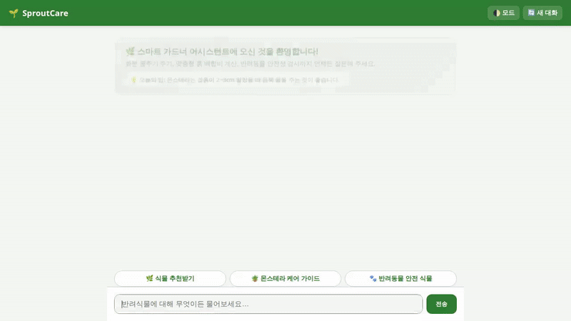

# SproutCare (스프라우트케어)



SproutCare는 반려식물 부모들이 식물의 건강을 진단하고, 관리 일정을 기록하며, 실내 식물과 가드닝 용품 카탈로그를 탐색할 수 있도록 돕는 대화형 에이전트(Agent)입니다. 

---

## 주요 구현 기능 (Features)

현재 SproutCare 에이전트에 완전히 구현되어 구동 중인 핵심 기능은 다음과 같습니다:

- **장기 기억 (Memory Bank)**  
  사용자의 조도 환경(예: 남향, 저광량), 알레르기 유무, 식이 제한, 반려동물 안전성 선호도 및 사용자의 가드닝 숙련도를 지속적으로 기억하여 다음 대화와 추천에 반영합니다.
- **클라우드 데이터베이스 (Cloud Firestore)**  
  방대한 식물 카탈로그를 조회하고, 상세 관리 가이드(물주기, 광량 등)를 검색하며, 사용자가 현재 키우고 있는 식물 목록과 물주기 일정을 Firestore에 기록하고 조회합니다.
- **파이썬 샌드박스 (Agent Engine Sandbox)**  
  LLM의 환각(Hallucination) 없이, 안전하게 격리된 Python 환경을 통해 화분 크기와 식물 종에 기반한 흙 배합비(상토, 펄라이트, 바크 비율) 및 비료 희석량을 정확히 계산합니다.
- **위치 기반 검색 (Google Maps API)**  
  주소를 좌표로 변환하고 주변 꽃집, 가드닝 샵, 식물원 등을 검색하여 오프라인에서 식물을 구매할 수 있도록 안내합니다.
- **식물 및 화분 이미지 생성 (Gemini Imagen 3 & Cloud Storage)**  
  원하는 식물의 6개월 뒤 성장 모습이나, 특정 인테리어에 어울리는 화분 이미지를 동적으로 생성한 후 Cloud Storage에 저장하여 사용자에게 보여줍니다.
- **식물 시연 비디오 생성 (Gemini Veo)**  
  물주기 시연, 식물 관리 방법 등을 짧은 타임랩스나 영상으로 생성하고 Cloud Storage를 통해 제공합니다.
- **풍부한 구조화 UI (A2UI)**  
  단순한 텍스트 응답을 넘어 식물 정보 카드, 흙 배합 및 물주기 테이블, 생성된 이미지와 비디오를 하나의 프론트엔드 채팅 인터페이스 안에서 직관적으로 렌더링합니다.

---

## 계획됨(미구현) 기능
- **실시간 날씨 API 연동**: 현재 지역의 날씨와 습도를 조회하여 물주기 주기를 동적으로 조절하는 기능은 아직 구현되지 않았습니다. (계획됨(미구현))

---

## 로컬 실행 방법 (Installation & Usage)

이미 클라우드에 배포된 Agent Engine을 활용하여 로컬에서 프론트엔드를 구동하는 방법입니다.

### 1. 가상환경 활성화 및 의존성 설치
```bash
# 프로젝트 루트 디렉토리(sproutcare)에서 진행
source .venv/bin/activate
cd frontend
pip install -r requirements.txt
```

### 2. 환경 변수 설정
배포된 에이전트 런타임의 엔드포인트를 환경변수로 설정합니다.
```bash
export AGENT_ENGINE_RESOURCE_NAME="projects/625300775459/locations/us-east1/reasoningEngines/9181253044929560576"
```

### 3. 프론트엔드 서버 실행
```bash
python main.py
```
서버가 시작되면 웹 브라우저에서 화면에 표시되는 로컬 호스트 주소로 접속하여 SproutCare 에이전트와 대화할 수 있습니다.
